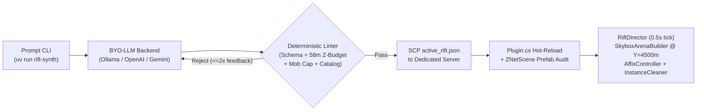

<div align="center">

```text
╦  ╦╔═╗╦  ╦ ╦╔═╗╦╔╦╗   ╦═╗╦╔═╗╔╦╗   ╔═╗╦ ╦╔╗╔╔╦╗╦ ╦
╚╗╔╝╠═╣║  ╠═╣║╣ ║║║║───╠╦╝║╠╣  ║ ───╚═╗╚╦╝║║║ ║ ╠═╣
 ╚╝ ╩ ╩╩═╝╩ ╩╚═╝╩╩ ╩   ╩╚═╩╚   ╩    ╚═╝ ╩ ╝╚╝ ╩ ╩ ╩
  BYO-LLM Mythic+ Skybox Dungeon Synthesizer for Valheim 1.0.21+
```

[](#)
[](#why-it-hits-different)
[](#)
[](#)
[](LICENSE)

Type a natural-language dungeon prompt on your laptop. Within seconds, an LLM architects a **Mythic+ Keystone Rift**, passes a deterministic **Potato-PC & Z-span linter**, SCPs a hot-reloaded manifest to your dedicated Linux server, and materializes an indestructible Black Marble arena **4,500 meters in the sky**—complete with wave gates, seasonal Kiss/Curse affixes, a Keystone par clock, and timed bonus chests.

**Your friends join on 100% unmodded, vanilla Steam Valheim clients.**

</div>

---

## Why It Hits Different

* **Zero Client Mods (100% Server-Authoritative ZDOs)** — No Jotunn, no custom asset bundles, no modpack sync headaches. Arenas, gates, lightning telegraphs, and chests are constructed exclusively from vanilla Valheim `ZNetScene` prefabs (`blackmarble_floor_large`, `blackmarble_2x2x1`, `iron_grate`, `dvergrprops_lantern_standing`) flagged indestructible (`WearNTear.m_noRoofWear = true`, ZDO health `1e9f`).
* **Grid-Deterministic Topology (No LLM Float Hallucinations)** — The LLM never emits raw `x, y, z` coordinates. It composes a North-to-South (`+Z`) graph of discrete room templates and assigns curated vanilla creatures to named tactical sockets (`sniper_perch_ne`, `center`, `north_left`, etc.).
* **Potato-PC Single-Zone Guarantee** — Every Rift is mathematically constrained to `<= 58m` inside a single `64m x 64m` Valheim zone center (`zoneX * 64f, 4500f, zoneZ * 64f`) with a hard cap of `<= 10` mobs per wave (`<= 12` active AI). Clients never cross a zone boundary mid-pull and never eat a `Resources.UnloadUnusedAssets()` GC hitch.
* **Self-Healing BYO-LLM Pipeline** — Works out of the box with local **Ollama** (`qwen3.6`, `llama3.3`, etc.), any **OpenAI-compatible** endpoint (`vLLM`, `LiteLLM`, OpenAI), or native **Google Gemini** (`google-genai`). If the model hallucinates an item name or blows the 58m Z-budget, `validator.py` feeds exact diagnostics back to the model (up to 2 retries) before anything touches the server.
* **Zero-Restart Hot Reload & Leak-Free Teardown** — `ValheimRiftEngine.dll` watches `active_rift.json` live, validates every prefab against `ZNetScene.instance`, and tracks every spawned `ZDOID` so `InstanceCleaner` reclaims ZDO ownership (`SetOwner`) and wipes 100% of the skybox on completion or abort.

---

## Architecture



### Live CLI Synthesis Output

```text
$ uv run --project tools/rift_synth rift-synth \
  "Keystone 5 Dwarven Forge Run: heavy fire mages and armored brutes, punish doorway camping, reward aggressive melee"

[rift-synth] Attempt 1/3 via openai-compatible (qwen3.6:35b-a3b-q8_0 @ http://localhost:11434/v1) ...
[rift-synth] Validated RiftManifest 'dwarven-forge-k5' in 1 attempt(s) -> active_rift.json
══════════════════════════════════════════════════════════════════════════
══════════════ SKYBOX RIFT TOPOLOGY: The Dwarven Forge (+5) ══════════════
 ID: dwarven-forge-k5 | Altitude: Y=4500m | Z-Span: 52m / 58m MAX
 Scaling: HP x1.90, DMG x1.50 | Par Timer: 06:00
 Affixes: molten_slag, bolstering, thunder_blessing
══════════════════════════════════════════════════════════════════════════
                      ▲  NORTH (+Z) — BOSS SANCTUM DAIS  ▲

         ┌────────── Room 2: sanctum_oct (20m x 20m) ───────────┐
         │ Pillars: center_los_blocker                          │
         │ Wave 0 (5/10 mobs):                                  │
         │   • 1x DvergerMageFire (★) @ north_left              │
         │   • 1x DvergerMageFire (★) @ north_right             │
         │   • 2x Dverger (0★) @ south_left                     │
         │   • 1x DvergerMageFire (★★) @ center [BOSS]          │
         │ [Victory: Chest + Linked Return Portal]              │
         └──────────────────────────────────────────────────────┘
                               │  4m Hall  │
                               ╞═══GRATE═══╡  (Gate 1)
                               │  4m Hall  │
         ┌──────── Room 1: crucible_square (16m x 16m) ─────────┐
         │ Pillars: four_corners                                │
         │ Wave 0 (4/10 mobs):                                  │
         │   • 1x DvergerMageFire (★) @ sniper_perch_ne         │
         │   • 1x DvergerMageFire (★) @ sniper_perch_nw         │
         │   • 2x Dverger (0★) @ center                         │
         └──────────────────────────────────────────────────────┘
                               │  4m Hall  │
                               ╞═══GRATE═══╡  (Gate 0)
                               │  4m Hall  │
         ┌───────── Room 0: entry_vestibule (8m x 8m) ──────────┐
         │ Pillars: none                                        │
         │ [SAFE STAGING BOX — 5s Keystone Countdown Brazier]   │
         └──────────────────────────────────────────────────────┘

                      ▼  SOUTH (-Z) — PARTY ENTRY SPAWN  ▼
──────────────────────────────────────────────────────────────────────────
 Base Chest Drops : 150x Coins, 20x Iron, 10x Silver
 Timed Bonus Drops: 1x SwordSilver (Q3), 5x MeadHealthMajor
══════════════════════════════════════════════════════════════════════════
[rift-synth] Hot-reload manifest deployed to babbagebox-rtx-lan:.../active_rift.json!
```

---

## Mythic+ Mechanics

### Keystone Scaling & Upgrade Tiers

For Keystone Level $L \in [1, 15]$:

$$\text{HP Multiplier} = 1.0 + 0.18L \qquad\qquad \text{Damage Multiplier} = 1.0 + 0.10L$$

Beating the **Par Timer** upgrades the Keystone and injects bonus loot stacks into the `sanctum_oct` victory chest:

| Clear Speed vs. Par Time | Rating | Chest Loot |
| :--- | :---: | :--- |
| `elapsed <= 0.60 * par` | **+3 Keystone Upgrade** | Base Drops + **3x** Timed Bonus Rolls |
| `elapsed <= 0.80 * par` | **+2 Keystone Upgrade** | Base Drops + **2x** Timed Bonus Rolls |
| `elapsed <= 1.00 * par` | **+1 Keystone Upgrade** | Base Drops + **1x** Timed Bonus Roll |
| `elapsed > 1.00 * par` | **Depleted (Cleared)** | Base Drops Only |

### Seasonal Kiss / Curse Affixes

Every synthesized Rift pairs **1–2 Negative Affixes** with at least **1 Positive Seasonal Kiss Affix**:

| Affix | Type | Server-Side Mechanics |
| :--- | :---: | :--- |
| `molten_slag` | Curse | Every `6s` in combat, stationary players get a `2s` fiery telegraph (`vfx_FireWork_SurtlingCore`) under their feet followed by a lava burst (`fx_blobLava_explosion`). Move or burn. |
| `bolstering` | Curse | Dying non-boss Rift mobs empower nearby Rift allies within `8m` (`+15%` damage & visual warcry pulse per stack). |
| `shielded_pack` | Curse | One elite per multi-mob wave is immune to all damage (`vfx_blocked` feedback) until its pack adds are eliminated. |
| `thunder_blessing` | **Kiss** | Aggressive players maintaining `> 50%` stamina unleash chain lightning (`fx_Lightning` + `fx_chainlightning_hit`) across up to 4 nearby enemies every `10s` in melee range. |

### Procedural Room Templates

| Template | Footprint | Role & Features |
| :--- | :---: | :--- |
| `entry_vestibule` | `8m x 8m` | Safe staging room (`room_index: 0`) with standing brazier & locked exit `iron_grate` during the 5s countdown. |
| `crucible_square` | `16m x 16m` | Open brawl chamber with elevated `2m` NE/NW sniper perches and configurable `pillar_layout` (`none`, `four_corners`, `center_los_blocker`). |
| `gauntlet_bridge` | `8m x 16m` | Narrow chasm bridge flanked by recessed hazard trenches, standing Dvergr lanterns, and sniper perches. |
| `sanctum_oct` | `20m x 20m` | Chamfered octagonal vaulted boss chamber (`10m` ceiling) with north victory dais, loot chest, and linked return portal. |

---

## Quickstart

### Prerequisites

* **Dev Host**: `.NET SDK 8+`, `Python 3.12+` with [`uv`](https://docs.astral.sh/uv/), `rsync` / `ssh` access to your Valheim host.
* **Valheim Dedicated Server**: Linux x86_64 running Valheim `1.0.21+` + `BepInExPack_Valheim 5.4.2351+`.

### 1. Sync Assemblies, Build & Deploy Mod

```bash
# 1. Pull Valheim + BepInEx reference DLLs from your server into .lib/ (gitignored)
make sync-libs BABBOX_HOST=your-server-ssh-alias

# 2. Compile ValheimRiftEngine.dll (publicizes assembly_valheim.dll automatically)
make build-mod

# 3. Provision isolated RiftSandbox (UDP 2458-2459) & deploy ValheimRiftEngine.dll
make deploy-mod

# 4. Verify 83/83 prefab audit & hot-reload watcher
make logs
```

### 2. Configure Your BYO-LLM Provider

Pick **any** of the three supported modes:

```bash
# Option A: Local Ollama (auto-detected if running on localhost:11434 — zero config needed!)
ollama pull qwen3.6:35b-a3b-q8_0

# Option B: Any OpenAI-Compatible Endpoint (OpenAI, vLLM, LiteLLM, OpenRouter)
export RIFT_LLM_BASE_URL="https://api.openai.com/v1"
export RIFT_LLM_API_KEY="sk-..."
export RIFT_LLM_MODEL="gpt-4.1"

# Option C: Native Google Gemini
export GEMINI_API_KEY="AIza..."
export RIFT_LLM_MODEL="gemini-2.5-pro"
```

### 3. Synthesize & Hot-Reload a Rift

```bash
make synth-rift PROMPT="Keystone 8 Swamp Crypt: poison oozes, sniper draugr on perches, abomination boss, anti-camping"
```

Or invoke the CLI directly with `--dry-run` to preview the ASCII topology locally without SCP deployment:

```bash
uv run --project tools/rift_synth rift-synth --dry-run \
  "Keystone 12 Ashlands Hellfire Gauntlet: charred warlocks and morgen apex boss"
```

---

## In-Game Commands (Zero-Mod Vanilla Clients)

> **Note on Vanilla Chat:** Unmodded Valheim intercepts a leading `/` locally (`Terminal.TryRunCommand`). Type `!rift <cmd>` directly in normal chat (`Enter`), or prefix with `/s /rift <cmd>`.

| Command | Access | Description |
| :--- | :---: | :--- |
| `!rift status` | Anyone | Displays active or staged Rift title, Keystone level, Z-span, affixes, and live wave/timer progress. |
| `!rift start` | Anyone | Saves pre-Rift coordinates for all players within `20m`, teleports the party to `Y = 4500m`, and starts the 5s countdown. |
| `!rift leave` | Anyone | Teleports you back to your saved pre-Rift world coordinates after a completed run (or walk through the spawned return portal). |
| `!rift reload` | Admin | Forces an immediate re-read and validation of `BepInEx/config/ValheimRiftEngine/active_rift.json`. |
| `!rift kit dwarf` | Admin | Grants maxed Q4 Carapace Armor, Feather Cape, Battleaxe, Carapace Shield, and endgame food/meads for instant sandbox testing. |
| `!rift abort` | Configurable | Emergency teardown: teleports all participants back to the surface and destroys every Rift ZDO in the skybox. |

---

## Repository Layout

```text
valheim-rift-synth/
├── GEMINI.md                             # Architectural spec & guardrails
├── Makefile                              # sync-libs, build-mod, deploy-mod, synth-rift, logs
├── schemas/
│   └── rift_manifest.schema.json         # Single-source-of-truth Draft 2020-12 contract
├── tools/
│   └── rift_synth/
│       ├── pyproject.toml                # uv project (openai, google-genai, pydantic, jsonschema)
│       ├── room_catalog.py               # 36 vanilla creatures, 26 rewards, templates & sockets
│       ├── validator.py                  # Deterministic Potato-PC, Z-span & boss/affix linter
│       └── cli.py                        # BYO-LLM -> retry loop -> ASCII preview -> SCP deploy
└── src/
    └── ValheimRiftEngine/
        ├── ValheimRiftEngine.csproj      # netstandard2.1 + BepInEx.AssemblyPublicizer.MSBuild
        ├── Plugin.cs                     # Entrypoint, 83-prefab ZNetScene audit, hot-reload watcher
        ├── Models/
        │   └── RiftManifest.cs           # Zero-dependency RFC 8259 JSON parser + DTO validator
        ├── Generation/
        │   ├── SkyboxArenaBuilder.cs     # Indestructible Black Marble rooms + gates @ Y=4500f
        │   └── InstanceCleaner.cs        # ZDO ownership reclamation & deterministic teardown
        ├── Runtime/
        │   ├── RiftDirector.cs           # 0.5s coroutine state machine, waves, timer, loot & portal
        │   └── AffixController.cs        # Server-authoritative M+ Kiss/Curse affixes
        └── Patches/
            ├── ChatCommandPatch.cs       # ZRoutedRpc Say interceptor (!rift & /rift)
            └── CombatHooksPatch.cs       # Character.RPC_Damage & OnDeath affix/kill hooks
```

---

## License

Released under the [MIT License](LICENSE). Copyright (c) 2026 Drew Vandagriff (DREW-V Labs).


---

<div align="center">

**DREW-V LABS** // **Drew Vandagriff** — *Dallas, TX*  
`Simplicity in Architecture · Efficiency in Engineering · Purity in Science · Audacity in Art · Life in Logic`

</div>
